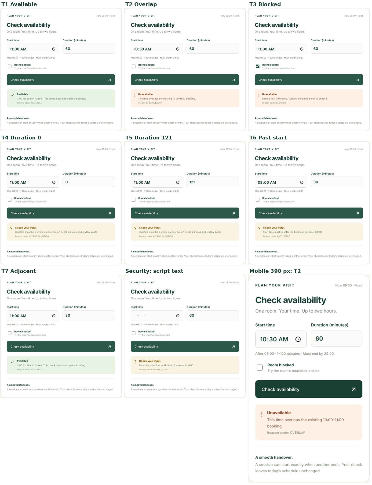
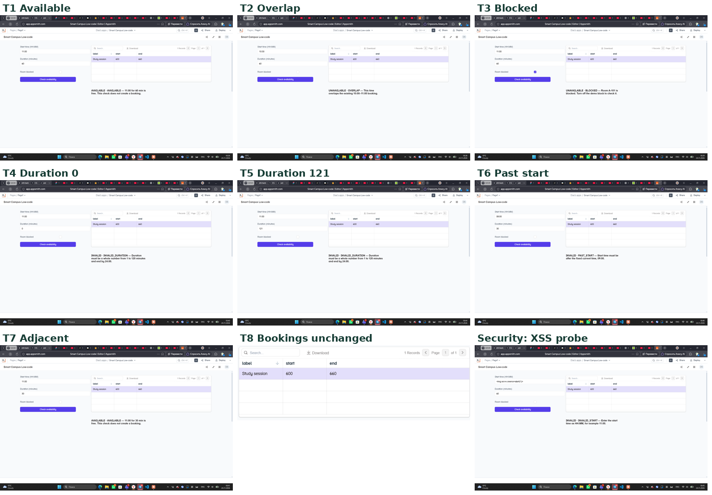
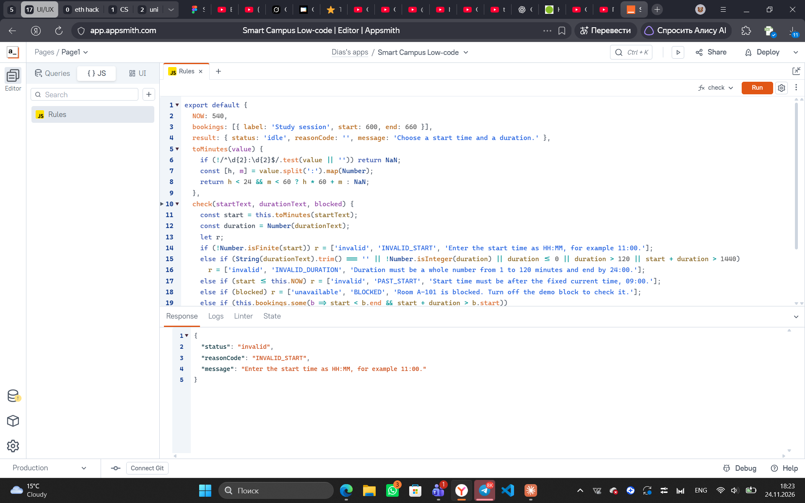
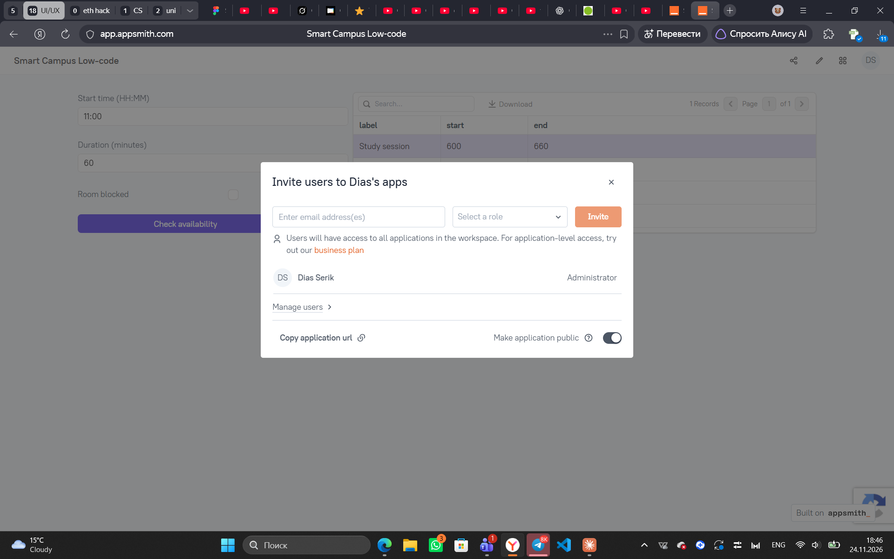
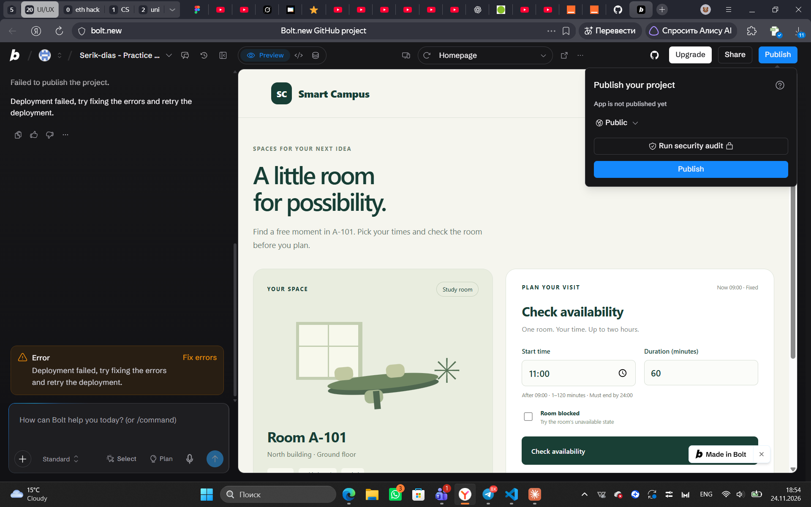

# Practice Work #12 — Code-based vs low-code: Smart Campus Room Availability Checker

**Student:** Serik Dias · **ID:** 24B032021 · **Class:** Tuesday 16:00–19:00 · 24 Nov 2026
**AI tool:** Claude (Anthropic), model Claude Opus 5.5, used through the Claude app

| | Link |
| --- | --- |
| Code-based live demo (Bolt publish) | https://serik-dias-practice-wcmq.bolt.host |
| Low-code app (Appsmith, public) | https://app.appsmith.com/app/smart-campus-low-code/page1-6b058e5b998af5f9e41e0411 |
| Source repository | https://github.com/Serik-Dias/Practice-12 |

**Result:** both versions pass all 8 shared tests (8/8 each). **Recommendation:** keep the code-based version as the main solution; it has automated tests, Git history and full portability. The low-code version was faster to assemble but its tests were manual and the app is not under version control.

## Task 01 — Frozen baseline

- **Version:** the final Smart Campus project from Practices 10–11, committed as checkpoint `f96f831` before any change.
- **Booking data:** one fictional booking, "Study session" 10:00–11:00 (600–660 minutes). Fixed current time 09:00 (540). Room A-101.
- **Checks:** `npm test` **42/42 passed**, `npm run build` passed (`evidence/logs/01–02`). Baseline screenshot: `evidence/00-baseline-code-based.png`.
- **Rules not changed:** `src/booking.js` (overlap, blocked, past, duration rules) is untouched in both versions. Both use the same fixture, the same order of checks and the same messages.

## Task 02 — Common contract

**User story:** As a student, I want to choose a start time and a duration and see whether Room A-101 is free, with a clear reason, so that I can plan my visit.

| AC | Requirement | Reason code |
| --- | --- | --- |
| AC1 | Start time must be in the future (after 09:00) | `PAST_START` |
| AC2 | Duration > 0 and ≤ 120 minutes (whole minutes, must end by 24:00) | `INVALID_DURATION` |
| AC3 | Overlapping bookings are unavailable; touching endpoints are allowed | `OVERLAP` |
| AC4 | A blocked room is unavailable | `BLOCKED` |
| AC5 | Show a clear decision without changing existing bookings | — |
| AC6 | Invalid input gets understandable feedback | `INVALID_START`, `INVALID_DURATION`, `PAST_START` |

| Part | Definition |
| --- | --- |
| Inputs | start time `HH:MM`, duration (minutes), blocked flag, fictional bookings `[{ label, start, end }]` |
| Outputs | `available` (boolean), `status` (available / unavailable / invalid), `reasonCode`, visible `message` |
| Check order | INVALID_START → INVALID_DURATION → PAST_START → BLOCKED → OVERLAP → AVAILABLE |
| Shared test inputs | `src/contract.js` (`TEST_CASES` T1–T8), written before either implementation |

## Task 03 — Code-based solution

React + Vite, published from Bolt. Layers are separated:

| File | Layer |
| --- | --- |
| `src/validation.js` | Turns form text into minutes or a validation reason |
| `src/availability.js` | Decision: validation first, then the unchanged rule engine `src/booking.js` |
| `src/App.jsx` | Display only: start time + duration form, three result states (Available / Unavailable / Check your input), reason code |
| `src/contract.js` | Shared fixture, messages, test cases |

Checks: `npm test` **51/51** (30 original rule tests + 16 contract tests + 5 UI tests), `npm run lint` and `npm run build` pass (`evidence/logs/03–05`). The UI was checked in a real browser at 1280 px and 390 px (`evidence/code-based/`). The two old UI test files were replaced because the form changed from "end time" to "duration", as the scenario requires; the rule tests were kept unchanged. The optional Practice 11 explanation feature was left out, because Practice 12 does not require it and it needs a server.

## Task 04 — Low-code solution (Appsmith, free cloud plan)

Built by the student in Appsmith from the steps and JS object prepared with the AI assistant.

- **Widgets:** `StartInput` (text, `HH:MM`), `DurationInput` (number), `BlockedCheckbox`, button, `ResultText`, `Table1` bound to the bookings.
- **Logic:** one JS object `Rules` (copy in `evidence/low-code/Rules.js`) with the same fixture, check order and messages as `src/contract.js`. The button calls `Rules.check(StartInput.text, DurationInput.text, BlockedCheckbox.isChecked)`.
- **Script use:** platform expressions alone could not express the overlap rule and ordered validation cleanly, so a small JS object was necessary.
- **What the platform did not give for free:** coloured result states (the result is plain text); automated tests (all checks were manual); version control (Git sync is offered but was not connected).
- **Simulated / not verified:** the 390 px mobile layout of the Appsmith app was not tested. Logic parity was additionally checked by running the same JS object in Node.js against the code-based function: **16/16 identical** reason codes and messages (`evidence/logs/07`). This was not a run inside Appsmith.

## Task 05 — Identical tests

| ID | Input (start, duration, blocked) | Expected | Code-based observed | Low-code observed |
| --- | --- | --- | --- | --- |
| T1 | 11:00, 60, no | Available | Available · AVAILABLE (test + browser) | AVAILABLE · AVAILABLE |
| T2 | 10:30, 60, no | Unavailable · OVERLAP | Unavailable · OVERLAP | UNAVAILABLE · OVERLAP |
| T3 | 11:00, 60, yes | Unavailable · BLOCKED | Unavailable · BLOCKED | UNAVAILABLE · BLOCKED |
| T4 | 11:00, 0, no | Validation error | Check your input · INVALID_DURATION | INVALID · INVALID_DURATION |
| T5 | 11:00, 121, no | Validation error | Check your input · INVALID_DURATION | INVALID · INVALID_DURATION |
| T6 | 08:00, 30, no | Validation error | Check your input · PAST_START | INVALID · PAST_START |
| T7 | 11:00, 30, no | Available (touches end of booking) | Available · AVAILABLE | AVAILABLE · AVAILABLE |
| T8 | after all checks | Bookings unchanged | Unit test passes; schedule still shows one 10:00–11:00 booking | Table still shows 1 record: Study session 600–660 |
| **Total** | | | **8 / 8** | **8 / 8** |

Code-based evidence: `evidence/logs/03-code-based-test.txt`, `evidence/code-based/`. Low-code evidence: `evidence/low-code/T1–T8` screenshots (student, 18:38–18:45).

## Task 06 — Engineering effort

| Measure | Code-based | Low-code |
| --- | --- | --- |
| Setup | Existing repo; `npm ci` | Appsmith sign-in and new app (≈ 5 min) |
| Implementation | AI-generated layers + tests: 2 min of agent time (13:16 → 13:18 UTC in `evidence/logs/timing.txt`), then reviewed | JS object pasted by 18:23; widgets configured by 18:35 (≈ 20 min) |
| Debugging | 1 defect: Bolt publish failed because the app sat in a sub-folder; fixed by moving files to the root (≈ 8 min, 18:46 → 18:54) | 1 defect: "Room blocked" default was on; switched off (≈ 1 min) |
| Testing | 51 automated tests (≈ 3 s per run) + scripted browser run | 8 manual tests + XSS probe with screenshots (≈ 7 min) |
| Acceptance tests passed | 8/8 | 8/8 |
| Unresolved defects | 0 functional; GitHub repo still nests the app in a sub-folder unless fixed | 0 functional; mobile layout not tested |
| Review / export / versioning | Git commits, diff review, public repo | Changes live only in Appsmith; Git connect and JSON export available but not used |

**Measured vs impression:** the times above come from log timestamps and screenshot clocks. The low-code start time is approximate (≈ 18:16, when the build steps were sent). Code-based "agent time" is not comparable to human effort: it excludes reading and checking the generated code. My impression, not a measurement: low-code is quicker for the first screen, code is quicker to change and re-test.

## Task 07 — Security checklist (Lecture #12)

| Check | Code-based | Low-code (Appsmith) |
| --- | --- | --- |
| Input validation | Strict `HH:MM` regex, whole-minute duration 1–120, end ≤ 24:00 (`src/validation.js`) | Same rules in the `Rules` JS object |
| Injection / XSS output handling | React escapes output; the message never echoes rejected input (test X8). Script text in the start field → `INVALID_START`, no dialog (browser run) | `` in Start → `INVALID_START`, no alert (screenshot `SEC-xss-probe.png`) |
| Permissions / public sharing | Static public site; no accounts, no data to protect | App is **public** (anyone with the link). On the free plan, invited users get access to **all** apps in the workspace (`SEC-share-public.png`) |
| Secrets / connectors | No keys, no backend, no connectors | No datasources or API keys used |
| SCA (dependencies / platform) | `npm audit`: 3 advisories in dev tooling (vitest/tinypool), not in the browser bundle (`evidence/logs/06`). Updating them is our job | Platform and its dependencies are patched by Appsmith (SaaS); we cannot inspect or update them |
| DAST (safe manual runtime checks) | Manual browser checks on our own local and published app only | Manual checks on our own app only. No scanning of Appsmith or Bolt infrastructure |
| AI agent privileges | The assistant worked in a sandbox copy; no access to GitHub, Bolt or Appsmith accounts | Student kept full control of the Appsmith account |

## Comparison matrix

| Criterion | Code-based | Low-code |
| --- | --- | --- |
| Functional tests | **8 / 8** (automated + browser) | **8 / 8** (manual, screenshots) |
| Build and repair time | ≈ 2 min AI build + ≈ 8 min repair (publish fix) | ≈ 25 min build + ≈ 1 min repair |
| Customization | Full control: layout, colours per state, responsive 390 px tested | Widget properties only; plain-text result; mobile not tested |
| Security controls | Our validation + React escaping; we own dependency updates (3 dev advisories) | Same validation; platform patching by vendor; public link and workspace-wide invites |
| Versioning / portability | Git history, standard React/Vite, runs anywhere | Lives in Appsmith cloud; Git/JSON export possible but not set up; logic copied into repo by hand |
| Ongoing cost | $0 (Bolt free hosting, GitHub free) | $0 on the free plan (5 users); Business plan is about $15 per user per month |

**Recommendation:** use the code-based version for Smart Campus. The evidence for this: automated tests rerun in seconds, every change is reviewable in Git, and the app is portable. Appsmith is a reasonable choice for a quick internal prototype or admin screen, but here it would still need Git sync, automated checks and a mobile layout review before it could be maintained by a team.

## AI-use reflection

- **What AI generated:** the shared contract and test cases, the code-based validation and availability layers and tests, the Appsmith JS object and build steps, the security checklist draft and this report structure.
- **What I verified:** ran the tests and build; built the Appsmith app myself and ran all 8 tests plus the XSS probe by hand; published both apps; checked that the published Bolt site opens.
- **What I changed or labelled:** fixed the Bolt publish failure (sub-folder layout); switched off the default "blocked" state in Appsmith; marked the Node.js parity check as not being an Appsmith run; marked the Appsmith mobile layout and the low-code start time as not measured.

Sources for plan limits: Appsmith pricing summaries (free plan: up to 5 cloud users, 3 Git repos, public apps), checked 24 Nov 2026.

## Appendix — Screenshots

**A1. Code-based version: T1–T7, script-text probe and 390 px mobile (browser run)**  

**A2. Low-code version (Appsmith): T1–T8 and XSS probe (student run)**  

**A3. Appsmith JS object and editor**  

**A4. Appsmith sharing: application public; invites cover the whole workspace**  

**A5. Code-based app running in Bolt before publishing**  

